## 安装

思源 → 集市 → 插件 → 搜索「简搜」→ 安装并启用。

- 需要思源 **v3.8.7+**
- 与「简易搜索」插件**完全互斥**，需先彻底卸载它（仅关闭开关无效）

## 最近更新

**v1.3.7**（从旧版升级请先看最后一条）

- 新增**指令补全**：输入 `-` / `--` 自动列候选，也可随时按 `Tab` 调出
- 新增**指令配置**：在设置里给任意指令改名、换字符、关掉
- 设置面板独立成对话框，分七个分类，支持重置所有和未保存提醒
- 块类型增加提示块、页签、思维导图、数据库、音视频等 14 种
- **默认不再自动弹出**历史记录和补全，改为按 `Alt+↓` / `Tab` 手动调出
- ⚠ 文档模式由 `-e` 改为 `||`，排除词由 `-词` 改为 `!词`，超级块由 `s` 改为 `S`

完整记录见 [CHANGELOG.md](CHANGELOG.md)。

## 30 秒上手

| 输入 | 效果 |
|---|---|
| `-dhc 历史用户` | 搜文档 / 标题 / 代码块，结果按此顺序排 |
| `历史 !中苏 -dhi` | 搜「历史」，排除含「中苏」的块 |
| `ct>2025 中国` | 只看 2025 年后创建的 |
| `历史 -k` | 只搜当前文档 |
| `中国历史 苏联历史 \|\|` | 文档模式：整篇同时含两个词 |

搜索页顶部会显示简搜识别到的指令，下方给出解析结果。

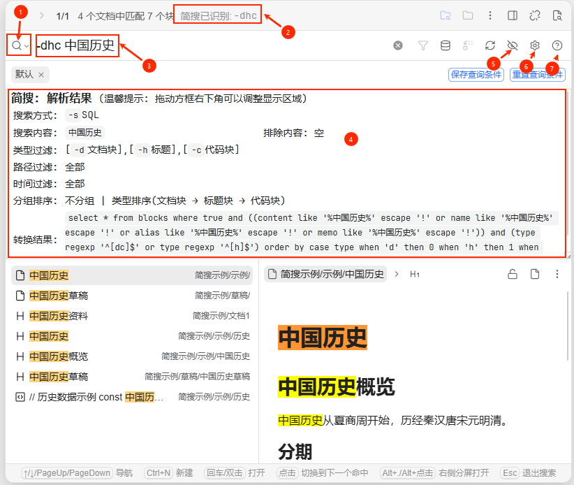

- **① 左侧图标**：点击打开思源原生历史记录；按 `Alt+↓` 打开简搜的历史记录
- **② 简搜已识别**：只列出被简搜消费的指令，悬浮可看含义
- **③ 搜索框**：直接输入指令和关键词
- **④ 解析结果**：搜索方式、内容、类型、路径、排序和最终转换出的语句
- **⑤ 眼睛**：显示 / 隐藏下方的解析结果区域
- **⑥ 齿轮**：打开简搜设置
- **⑦ 问号**：打开指令速查手册

> `设置 → 常规` 里可以关掉齿轮和问号两个按钮；眼睛按钮常驻，用来随时显隐下方的解析结果区。

## 搜索语法

怎么把查询写出来。

<details style="margin:12px 0">
<summary style="cursor:pointer;padding:10px 14px 10px 32px;background:var(--b3-theme-surface);border:1px solid var(--b3-border-color);border-radius:6px;font-weight:600;font-size:14px;color:var(--b3-theme-on-background)">全部语法（搜索方式 / 块类型过滤 / 路径过滤 / 时间过滤 / 排序 / 排除 / 文档模式 / kv）</summary>

<details style="margin:10px 0 10px 8px">
<summary style="cursor:pointer;padding:6px 12px 6px 28px;background:var(--b3-theme-surface);border-left:3px solid var(--b3-theme-primary);border-radius:0 4px 4px 0;font-weight:600;font-size:13px;color:var(--b3-theme-on-background)">搜索方式</summary>

输入里出现可识别的指令时，简搜会自动改用 SQL 搜索。想强制指定方式，用下列字符：

| 字符 | 模式 |
|---|---|
| `-w` | 关键字搜索 |
| `-q` | 查询语法 |
| `-s` | SQL |
| `-r` | 正则表达式 |

- 空格分隔时**可写在任意位置**：`中国历史 -w` 与 `-w 中国历史` 等价
- **连写**只在输入开头有效：`-w中国历史` ✅ ｜ `中国历史 -w中国历史` ❌

```text
-w-dh                      以关键字模式搜「-dh」
-q 中国历史 NOT 苏联
-s select * from blocks limit 5
-r 历.*史
```

<details style="margin:8px 0 8px 12px">
<summary style="cursor:pointer;padding:4px 10px 4px 24px;font-weight:500;font-size:12.5px;color:var(--b3-theme-on-surface)">各模式的效果截图</summary>


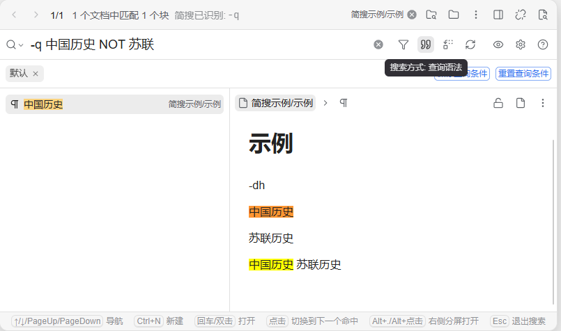
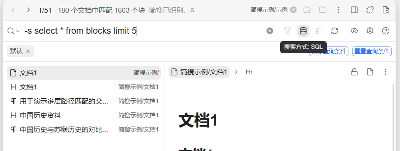
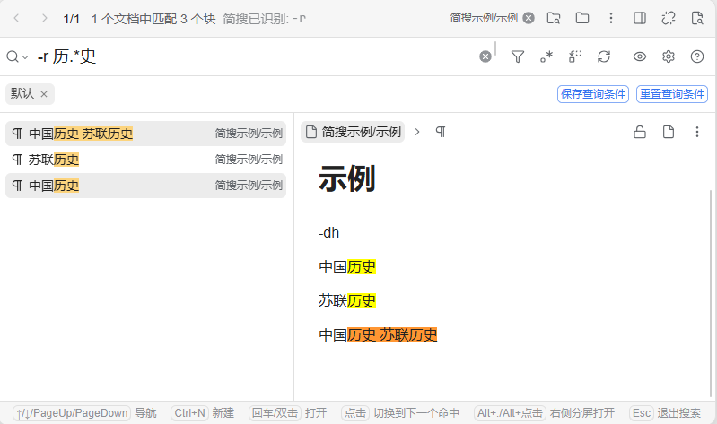

</details>

</details>

<details style="margin:10px 0 10px 8px">
<summary style="cursor:pointer;padding:6px 12px 6px 28px;background:var(--b3-theme-surface);border-left:3px solid var(--b3-theme-primary);border-radius:0 4px 4px 0;font-weight:600;font-size:13px;color:var(--b3-theme-on-background)">块类型过滤</summary>

`-` 后跟类型字符，可连写多个，结果按书写顺序排。

| 字符 | 类型 | 说明 |
|---|---|---|
| `d` | 文档块 | 仅匹配文档名 |
| `h` | 标题块 | 可加级别：`-h13` = 1、3 级标题 |
| `p` | 段落块 | |
| `c` | 代码块 | |
| `b` | 引述块 | |
| `l` | 列表块 | |
| `i` | 列表项块 | |
| `t` | 表格块 | |
| `m` | 公式块 | |
| `o` | 未完成待办 | |
| `O` | 已完成待办 | |
| `L` | 含外部链接的块 | 大写 L |
| `S` | 超级块 | 默认关闭，需在指令配置里启用 |

未指定类型时，沿用搜索页面当前勾选的类型。

`-dhc 中国历史`：搜文档、标题、代码块，结果按「文档 → 标题 → 代码块」排。

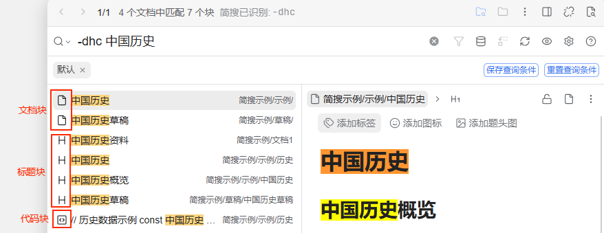

<details style="margin:8px 0 8px 12px">
<summary style="cursor:pointer;padding:4px 10px 4px 24px;font-weight:500;font-size:12.5px;color:var(--b3-theme-on-surface)">更多块类型（页签、挂件、数据库等，默认关闭）</summary>

这些类型默认关闭，需在 `设置 → 指令配置 → 块类型过滤` 里打开。启用后用 `--type=值` 或 `--值` 指定：

| 值 | 类型 |
|---|---|
| `callout` | 提示块（默认可用，`--type=callout`） |
| `tabs` / `tab` | 页签块 / 页签项块 |
| `mindmap` / `mindmap_item` | 思维导图块 / 项块 |
| `query_embed` | 嵌入块 |
| `widget` | 挂件块 |
| `av` | 数据库块 |
| `html` | HTML 块 |
| `custom` | 自定义块 |
| `tb` | 分割线 |
| `audio` / `video` / `iframe` | 音频 / 视频 / IFrame 块 |

多值用英文逗号：`--type=tabs,tab`。注意被关闭的项输入后会整段按关键词搜索。

</details>

</details>

<details style="margin:10px 0 10px 8px">
<summary style="cursor:pointer;padding:6px 12px 6px 28px;background:var(--b3-theme-surface);border-left:3px solid var(--b3-theme-primary);border-radius:0 4px 4px 0;font-weight:600;font-size:13px;color:var(--b3-theme-on-background)">路径过滤</summary>

| 写法 | 作用 |
|---|---|
| 不指定 | 沿用页面当前路径 |
| `-k` | 当前文档 |
| `-K` | 当前文档及子文档 |
| `-a` 或 `//` | 全部文档（取消页面路径） |
| `/a/b` | 路径包含 `a` 且文档名包含 `b` |
| `-/xxx` | 排除路径含 `xxx` 的结果 |

- 页面默认路径、`-k`/`-K`、`//` **三选一**
- 多层路径可与上述任一条件叠加（AND），也可写多个多层路径

```text
历史 -kphi                 当前文档中搜「历史」的段落、标题、列表项
//文档1/文档2 历史          全部笔记本下，路径含「文档1」、文档名含「文档2」
-/草稿 历史                排除路径含「草稿」的结果
```

`/文档1/文档2 中国历史`：路径过滤里能看到解析出的 `*文档1*/*文档2*`，结果只剩该路径下的块。

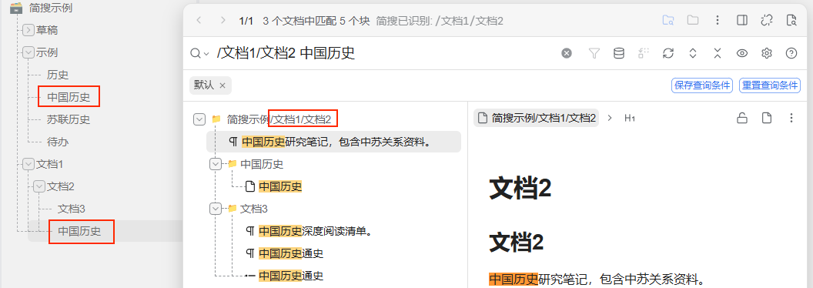

`中国历史 -k`：路径过滤变成「当前文档」，结果只来自正在看的这篇文档。

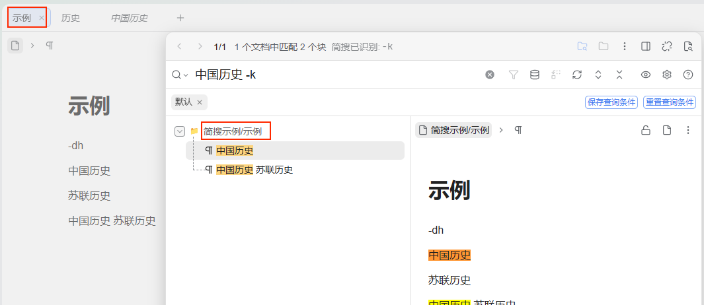

<details style="margin:8px 0 8px 12px">
<summary style="cursor:pointer;padding:4px 10px 4px 24px;font-weight:500;font-size:12.5px;color:var(--b3-theme-on-surface)">多层路径的匹配细节</summary>

- **模糊匹配但顺序严格**：`/f1/f3` 可匹配 `/f1/f2/f3` 或 `/ff11/f2/f3`，但不能匹配 `/f3/f1`
- **无关键词时**取第一个路径的最后一段当文件名：`//f1/f2 /f3/f4` → 路径含 `f1` 且含 `f3/f4`、文档名含 `f2`
- **有关键词时**路径只作过滤，额外按关键词搜
- **显式指定块类型时**（如 `-p`、`-dhi`），最后一段不再当文档名，也不会强制只搜文档块

</details>

</details>

<details style="margin:10px 0 10px 8px">
<summary style="cursor:pointer;padding:6px 12px 6px 28px;background:var(--b3-theme-surface);border-left:3px solid var(--b3-theme-primary);border-radius:0 4px 4px 0;font-weight:600;font-size:13px;color:var(--b3-theme-on-background)">时间过滤</summary>

过滤创建时间 `ct` / 更新时间 `ut`。比较符 `>` `<` `=`，其中 `=` 表示「以该时间开头」。时间写 1–14 位数字。

```text
ct<2025 中国                              2025-01-01 之前创建
ct=202511 中国                            2025 年 11 月创建
ut>20241020112233 中国                    2024-10-20 11:22:33 之后更新
ct>2024|ct<2021 ut>2022&ut<2023 中国      (ct>2024 或 ct<2021) 且 (ut>2022 且 ut<2023)
```

`&` 表示并且，`|` 表示或者；空格分隔的多个时间条件之间是「并且」。

> 注意：`ct<` / `ct>` 单独出现时是**排序**指令，带上比较符和时间才是**过滤**。

</details>

<details style="margin:10px 0 10px 8px">
<summary style="cursor:pointer;padding:6px 12px 6px 28px;background:var(--b3-theme-surface);border-left:3px solid var(--b3-theme-primary);border-radius:0 4px 4px 0;font-weight:600;font-size:13px;color:var(--b3-theme-on-background)">分组与排序</summary>

| 指令 | 作用 |
|---|---|
| `g<` / `g>` | 按文档分组 |
| `nog<` / `nog>` | 不分组 |
| `type<` / `type>` | 类型排序 |
| `cont<` / `cont>` | 原文内容顺序 |
| `ct<` / `ct>` | 创建时间升 / 降序 |
| `ut<` / `ut>` | 更新时间升 / 降序 |

- `g<` 与 `g>` 等价，`type<` 与 `type>` 等价——尖头**不表示方向**
- `ct`/`ut` 的尖头**表示**方向：`<` 升序，`>` 降序
- 多排序叠加要**用空格分开**：`type> ct> ut<` 依次生效
- 指定分组/排序后再取消指定，会恢复指定前的状态

```text
name -cph type> ct> ut<          不分组，类型降序 → 创建降序 → 更新升序
name -cph type> nog< ct> ut<     同上，显式写明不分组
name -cph type> g< ct> ut<       按文档分组，组内仅第一个排序生效
```

<details style="margin:8px 0 8px 12px">
<summary style="cursor:pointer;padding:4px 10px 4px 24px;font-weight:500;font-size:12.5px;color:var(--b3-theme-on-surface)">分组模式下的排序限制</summary>

分组时思源会强制按其内置逻辑排序，简搜无法干预最终结果：

- 所有排序效果与不用简搜时一致（文档按路径名升序）
- **只支持单个排序**，写多个只有第一个生效
- 「相关度」实际表现为按类型排序，并非真正的语义相关性
- 不分组时，「相关度」和 `cont` 排序均**不受支持**（无法用 SQL 模拟）

</details>

</details>

<details style="margin:10px 0 10px 8px">
<summary style="cursor:pointer;padding:6px 12px 6px 28px;background:var(--b3-theme-surface);border-left:3px solid var(--b3-theme-primary);border-radius:0 4px 4px 0;font-weight:600;font-size:13px;color:var(--b3-theme-on-background)">关键词排除</summary>

`!` 后跟要排除的词，可写多个。

```text
历史 !中苏 !美国 -dhi      搜含「历史」、不含「中苏」和「美国」的文档/标题/列表项
```

`中国历史 !苏联 -dhp`：解析结果里的「排除内容」会列出「苏联」，结果里不再出现含它的块。


- 只有关键词 + 排除词时走查询语法，关键词会加引号，`:`、括号等特殊字符不改变语义
- 只写排除词、没有关键词时走 SQL，避免生成无效查询

`历史!中苏` 会被当成一整个关键词——排除词前面必须有空格或行首。

</details>

<details style="margin:10px 0 10px 8px">
<summary style="cursor:pointer;padding:6px 12px 6px 28px;background:var(--b3-theme-surface);border-left:3px solid var(--b3-theme-primary);border-radius:0 4px 4px 0;font-weight:600;font-size:13px;color:var(--b3-theme-on-background)">文档模式</summary>

`||` 开启后，关键词按**整篇文档**判断：文档里包含所有关键词即算命中，命中的块只需含其中任意一个。

```text
中国历史 苏联历史 ||              整篇同时含「中国历史」和「苏联历史」的文档
中国 美国 -h || !苏联             同时含「中国」「美国」、不含「苏联」的文档下的标题块
```

| | 普通模式 | 文档模式 `\|\|` |
|---|---|---|
| 匹配单位 | 同一个块 | 整篇文档 |
| 输出 | 块 | 块（不是文档列表） |
| `!排除词` | 排除块 | 排除整篇文档 |

类型、时间、路径仍按块过滤。

</details>

<details style="margin:10px 0 10px 8px">
<summary style="cursor:pointer;padding:6px 12px 6px 28px;background:var(--b3-theme-surface);border-left:3px solid var(--b3-theme-primary);border-radius:0 4px 4px 0;font-weight:600;font-size:13px;color:var(--b3-theme-on-background)">kv 写法</summary>

每个指令都有等价的 `--key=值` 写法，多值用英文逗号：

| kv 写法 | 等价指令 |
|---|---|
| `--type=callout` | `--callout` |
| `--group=doc` / `--group=none` | `g<` / `nog<` |
| `--sort=type` / `--sort=ct:asc` | `type>` / `ct<` |
| `--sort=type,ct:desc` | `type> ct>` |
| `--time=ct>2025` | `ct>2025 关键词` |
| `--time=ct>2024\|ct<2021` | 同上 |

`--sort=` 可选值：`type`、`content`、`ct:asc`、`ct:desc`、`ut:asc`、`ut:desc`。

```text
历史 --type=callout
历史 --group=doc --sort=type
历史 --sort=type,ct:desc
历史 --time=ct>2025
```

</details>

</details>

## 输入辅助

输入时少打字。

<details style="margin:12px 0">
<summary style="cursor:pointer;padding:10px 14px 10px 32px;background:var(--b3-theme-surface);border:1px solid var(--b3-border-color);border-radius:6px;font-weight:600;font-size:14px;color:var(--b3-theme-on-background)">历史记录与指令补全</summary>

<details style="margin:10px 0 10px 8px">
<summary style="cursor:pointer;padding:6px 12px 6px 28px;background:var(--b3-theme-surface);border-left:3px solid var(--b3-theme-primary);border-radius:0 4px 4px 0;font-weight:600;font-size:13px;color:var(--b3-theme-on-background)">搜索历史</summary>

输入时默认**不会**自动弹出历史记录，需要时按 `Alt+↓` 调出；再按一次、`Esc`、点列表外或选中某项都会收起。

- `↑`/`↓` 在列表里预览，回车采用该条，`Esc` 取消并恢复手打内容
- 列表显示期间默认暂停搜索，结果区保留上一次的结果；想让搜索照常实时执行，关掉 `设置 → 历史记录 → 拦截搜索`
- 希望输入时自动出现，去 `设置 → 历史记录 → 自动显示历史记录` 选「智能显示」（有可用候选时才弹）或「总是显示」（输入不为空就弹，首行为当前输入）
- 想让自动弹出时只保留前缀匹配的记录，打开 `设置 → 历史记录 → 自动历史仅前缀匹配`；手动 `Alt+↓` 不受影响

点击搜索框左侧的图标（带下拉箭头）打开的是思源原生历史记录；按 `Alt+↓` 打开的才是简搜优化后的历史记录。

列表的图标区、选中样式和最大行数都在 `设置 → 历史记录` 里调整。


</details>

<details style="margin:10px 0 10px 8px">
<summary style="cursor:pointer;padding:6px 12px 6px 28px;background:var(--b3-theme-surface);border-left:3px solid var(--b3-theme-primary);border-radius:0 4px 4px 0;font-weight:600;font-size:13px;color:var(--b3-theme-on-background)">指令补全</summary>

输入时默认也**不会**自动列候选，按 `Tab` 手动调出；没有候选时列出全部指令，回车插入。

- 希望输入 `-`/`--` 就自动列候选，去 `设置 → 指令补全 → 自动显示指令补全` 打开
- 候选的排列顺序可在 `设置 → 指令补全 → 补全排序方式` 里改，默认按设置顺序
- 选「按使用次数」时，次数按搜索页会话统计：页签或弹窗打开期间用到的指令，关闭时各 +1

输入 `中国历史 -` 后按 `Tab`，弹出可用指令及其说明：


<details style="margin:8px 0 8px 12px">
<summary style="cursor:pointer;padding:4px 10px 4px 24px;font-weight:500;font-size:12.5px;color:var(--b3-theme-on-surface)">补全菜单的交互细节</summary>

- `--time=` 逐步引导：`ct`/`ut` → `<`/`>`/`=` → 日期 → `&` / `|` / 空格结束
- `--type=`、`--sort=` 支持逗号多值：选一个后菜单保持打开并追加逗号
- 自定义顺序按「单字符 / 多字符与 kv key / 各 key 的值」分组，可拖动排序、单独开关（开关仅自定义模式生效）
- 补全菜单打开期间暂停搜索；`-w`/`-q`/`-s`/`-r` 之后不补全

</details>

</details>

<details style="margin:10px 0 10px 8px">
<summary style="cursor:pointer;padding:6px 12px 6px 28px;background:var(--b3-theme-surface);border-left:3px solid var(--b3-theme-primary);border-radius:0 4px 4px 0;font-weight:600;font-size:13px;color:var(--b3-theme-on-background)">两个快捷键的共同规则</summary>

- 两个快捷键与两个自动显示开关相互独立：自动显示关着也能手动调出
- 推荐配置：自动显示关闭 + 快捷键开启，需要时手动调出
- 手动关闭后（再按一次 / `Esc` / 点列表外 / 选中项），本页内继续输入不会自动弹出
- 列表超出高度时，上下边缘悬浮显示「还有 N 项」，不占位

</details>

</details>

## 结果展示

搜索结果怎么显示。

<details style="margin:12px 0">
<summary style="cursor:pointer;padding:10px 14px 10px 32px;background:var(--b3-theme-surface);border:1px solid var(--b3-border-color);border-radius:6px;font-weight:600;font-size:14px;color:var(--b3-theme-on-background)">搜索结果样式与回车创建</summary>

<details style="margin:10px 0 10px 8px">
<summary style="cursor:pointer;padding:6px 12px 6px 28px;background:var(--b3-theme-surface);border-left:3px solid var(--b3-theme-primary);border-radius:0 4px 4px 0;font-weight:600;font-size:13px;color:var(--b3-theme-on-background)">搜索结果样式</summary>

默认就接管结果并按「原生树」显示，**但只在按文档分组时生效**；不分组的搜索结果保持思源原样。

| 样式 | 效果 |
|---|---|
| 原生列表 | 不改样式，只改文档顺序 |
| 原生树 / 多彩树 / eDiary 树 | 按树结构显示 |

- 样式在 `设置 → 搜索结果 → 搜索结果样式` 里选，默认「原生树」
- 想让分组标题显示完整路径而不是只有文档名，默认已开 `显示全路径`；关掉则只显示文档名
- 命中的结果默认排在所属分组上方，由 `搜索结果优先` 控制（以上两项都是树结构生效）
- 想完全恢复思源原生的结果列表，关掉 `接管搜索结果`

三种树样式对比（同一份搜索结果）：

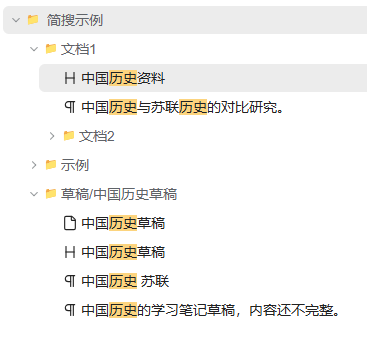
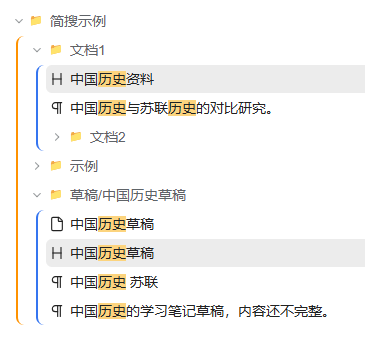
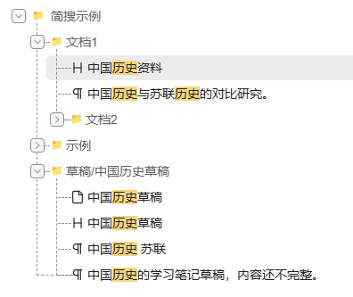

</details>

<details style="margin:10px 0 10px 8px">
<summary style="cursor:pointer;padding:6px 12px 6px 28px;background:var(--b3-theme-surface);border-left:3px solid var(--b3-theme-primary);border-radius:0 4px 4px 0;font-weight:600;font-size:13px;color:var(--b3-theme-on-background)">回车创建</summary>

搜索结果为空时，回车**不会**创建新文档，改为点击「点击创建」项创建，避免误建空文档。想恢复思源原生的回车创建，关掉 `设置 → 搜索结果 → 搜索结果为空时禁用回车创建`。

</details>

</details>

## 设置

简搜设置面板里能改什么。

<details style="margin:12px 0">
<summary style="cursor:pointer;padding:10px 14px 10px 32px;background:var(--b3-theme-surface);border:1px solid var(--b3-border-color);border-radius:6px;font-weight:600;font-size:14px;color:var(--b3-theme-on-background)">指令配置与七个设置分类</summary>

<details style="margin:10px 0 10px 8px">
<summary style="cursor:pointer;padding:6px 12px 6px 28px;background:var(--b3-theme-surface);border-left:3px solid var(--b3-theme-primary);border-radius:0 4px 4px 0;font-weight:600;font-size:13px;color:var(--b3-theme-on-background)">指令配置（改名 / 换字符 / 开关）</summary>

`设置 → 指令配置` 可视化编辑每个指令项，每项可配三种形式：

- **单字符**：只填字符，使用时会加 `-`。填 `h` → `-h`
- **多字符**：填完整指令，如 `--callout`。路径、时间类后面接内容作为参数
- **kv**：分别填 key 和值。`--type=` + `callout` → `--type=callout`；key 不带 `=` 时直接拼接

自定义多字符指令即使不以 `--` 开头（如 `xxcallout`）也会出现在 `--` 补全和 Tab 全部指令里；以 `@` 等符号开头时，输入该前缀会自动弹出补全。

- 关闭某一项后，输入对应指令会整段按关键词搜索
- 保存时校验单字符、多字符、kv 是否重复
- 简搜升级时会自动合并新增的默认项，已有的顺序、开关、自定义形式保持不变
- 底部「恢复默认」重置本页指令配置

</details>

<details style="margin:10px 0 10px 8px">
<summary style="cursor:pointer;padding:6px 12px 6px 28px;background:var(--b3-theme-surface);border-left:3px solid var(--b3-theme-primary);border-radius:0 4px 4px 0;font-weight:600;font-size:13px;color:var(--b3-theme-on-background)">七个分类各管什么</summary>

| 分类 | 主要内容 |
|---|---|
| 常规 | 简搜总开关、日志等级、阻止搜索的特殊输入、顶部按钮显隐、「简搜已识别」摘要 |
| 历史记录 | 自动显示三档、仅前缀匹配、Alt+↓ 快捷键、拦截搜索、行数上限、列表图标与选中样式 |
| 指令补全 | 自动显示、Tab 快捷键、行数上限、补全排序方式、自定义顺序 |
| 指令配置 | 各指令项的单字符 / 多字符 / kv 形式，改名、开关、恢复默认 |
| 搜索结果 | 空结果禁用回车创建、接管搜索结果、结果样式、结果优先、显示全路径 |
| 跳转效果 | 高亮关键词、闪烁当前块、光标定位样式（不处理 / 关键词之前 / 选中 / 之后） |
| 关于 | 版本信息、跳转手册、反馈入口 |

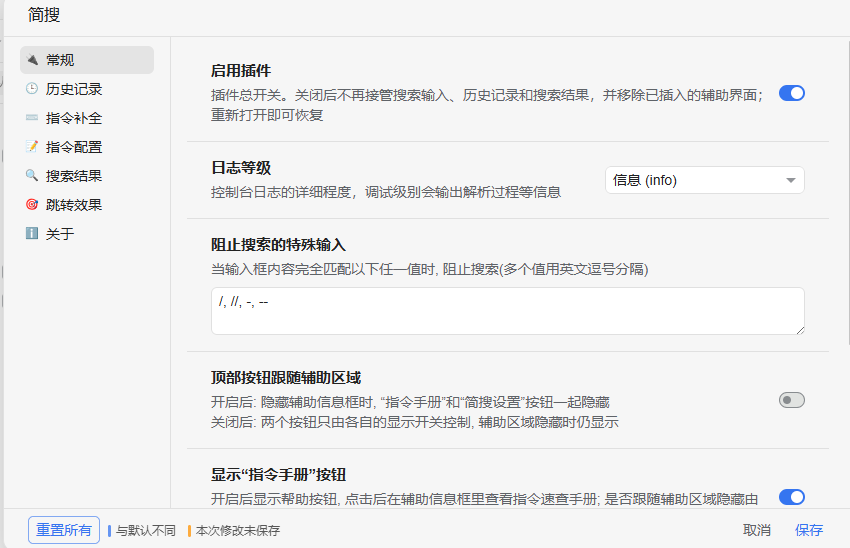

</details>

<details style="margin:10px 0 10px 8px">
<summary style="cursor:pointer;padding:6px 12px 6px 28px;background:var(--b3-theme-surface);border-left:3px solid var(--b3-theme-primary);border-radius:0 4px 4px 0;font-weight:600;font-size:13px;color:var(--b3-theme-on-background)">各设置项分别做什么</summary>

**常规**

- `启用插件`：总开关。关闭后不再接管搜索输入、历史记录和搜索结果，已插入的界面一并移除；重新打开即恢复
- `日志等级`：控制台日志的详细程度。排查问题时设为调试会输出解析过程，平时保持「信息」即可
- `阻止搜索的特殊输入`：输入框内容与其中任意一项**完全相同时不发起搜索**，默认 `/, //, -, --`。这样打到一半的指令不会立刻触发全库搜索
- `顶部按钮跟随辅助区域`：开启后隐藏解析结果区时，齿轮和问号按钮一起隐藏；关闭时两个按钮只由各自的开关控制
- `显示“指令手册”按钮` / `显示“简搜设置”按钮`：分别控制问号按钮和齿轮按钮是否出现在顶部
- `显示“简搜已识别”摘要`：控制顶部那行被消费的指令 token。关掉只是不显示，指令照常生效

**历史记录**

- `自动显示历史记录`：三档。`关闭`（默认）输入时不弹出，只能按 `Alt+↓` 调出；`智能显示` 有可用候选时才弹，与输入完全相同的项不算；`总是显示` 只要输入不为空就弹，首行为当前输入
- `历史列表快捷键 (Alt+↓)`：控制 `Alt+↓` 是否可用。它与自动显示**相互独立**，自动显示关着也能手动调出；手动状态只在当前搜索页有效，不改动设置
- `自动历史仅前缀匹配`：自动弹出时只保留前缀匹配的记录（精确匹配也算前缀），过滤掉包含和模糊匹配；手动 `Alt+↓` 不受影响。自动显示关闭时此项不可用
- `拦截搜索`：开启（默认）时列表显示期间暂停搜索，结果区保留上一次的结果；关闭后列表只作建议层，搜索照常实时执行
- `列表包含搜索框左侧历史图标`：开启时列表从搜索框最左边缘开始、盖住左侧历史图标；关闭时列表右移让开，图标和下拉箭头始终可见
- `列表选中样式`：`左侧蓝条`（默认）让条目铺满列表宽度、选中项左侧显示蓝条；`圆角浮起` 让条目与边界留距、选中项用浅色背景
- `历史记录行数上限(拦截开启)` / `历史记录行数上限(拦截关闭)`：列表最多显示几行。前者默认 15，后者默认 4；填 0 表示只受窗口高度限制。**两个上限按 `拦截搜索` 的开/关分别生效**，同一时间只有一个可编辑，改的时候注意当前是哪一档

**指令补全**

- `自动显示指令补全`：默认关闭。开启后输入 `-` 列出单字符指令、输入 `--` 列出多字符指令和 kv key、输入 kv key 后列出可选值；关闭后仍可用 `Tab` 手动调出
- `指令补全快捷键 (Tab)`：控制 `Tab` 是否可用。没有候选时列出全部指令、回车插入；手动状态只在当前搜索页有效
- `补全排序方式`：`按设置顺序`（默认）/ `按使用次数`（按搜索页会话统计，次数相同按设置顺序）/ `自定义`（按下方分组列表手动拖排）。自动显示和 `Tab` 都关闭时不可用
- `补全菜单行数上限`：补全列表最多显示几行，默认 15，填 0 表示只受窗口高度限制

**搜索结果**

- `搜索结果为空时禁用回车创建`：开启（默认）后搜不到结果时回车不会新建文档，改为点击「点击创建」项创建；关闭则恢复思源原生行为
- `接管搜索结果`：开启后按下方样式渲染结果。**仅在按文档分组时生效**
- `搜索结果样式`：`原生列表`（不改样式，只改文档顺序）/ `原生树` / `多彩树` / `eDiary 树`（按树结构显示）。需开启 `接管搜索结果`
- `搜索结果优先`：命中的结果排在所属分组上方，树结构生效
- `显示全路径`：分组标题显示完整路径而不是仅文档名，树结构生效

**跳转效果**

- `高亮关键词`：双击或回车跳到结果位置后，高亮命中的关键词
- `闪烁当前块`：跳转后让目标块闪一下。思源 v3.4.1 起原生已支持，建议关闭
- `光标定位样式`：跳转后光标落在哪里，可选不处理 / 关键词之前 / 选中关键词 / 关键词之后

</details>

<details style="margin:10px 0 10px 8px">
<summary style="cursor:pointer;padding:6px 12px 6px 28px;background:var(--b3-theme-surface);border-left:3px solid var(--b3-theme-primary);border-radius:0 4px 4px 0;font-weight:600;font-size:13px;color:var(--b3-theme-on-background)">修改标记与保存</summary>

- 与默认值不同的项左侧显示**蓝色竖线**；本次修改未保存的显示**橙色竖线**（橙色优先）
- 有未保存修改时关闭会提示「保存 / 不保存 / 继续编辑」；点「取消」直接放弃
- 左下角「重置所有」恢复全部默认并保存

</details>

</details>

## 常见问题

<details style="margin:12px 0">
<summary style="cursor:pointer;padding:10px 14px 10px 32px;background:var(--b3-theme-surface);border:1px solid var(--b3-border-color);border-radius:6px;font-weight:600;font-size:14px;color:var(--b3-theme-on-background)">指令不生效 / 列表不弹出 / 排序异常 / 插件冲突</summary>

<details style="margin:10px 0 10px 8px">
<summary style="cursor:pointer;padding:6px 12px 6px 28px;background:var(--b3-theme-surface);border-left:3px solid var(--b3-theme-primary);border-radius:0 4px 4px 0;font-weight:600;font-size:13px;color:var(--b3-theme-on-background)">输入指令没生效</summary>

1. 看搜索页顶部的「简搜已识别」摘要，没被列出的 token 没有生效
2. 检查该指令是否在 `设置 → 指令配置` 里被关闭
3. 检查是否有空格：`type> ct>` 是两个指令，`type>ct>` 会被当成一个关键词

</details>

<details style="margin:10px 0 10px 8px">
<summary style="cursor:pointer;padding:6px 12px 6px 28px;background:var(--b3-theme-surface);border-left:3px solid var(--b3-theme-primary);border-radius:0 4px 4px 0;font-weight:600;font-size:13px;color:var(--b3-theme-on-background)">设置了自动显示但列表不弹出</summary>

手动关闭过一次（`Esc` / 点列表外 / 选中项）后，当前搜索页内不会再自动弹出。按一次 `Alt+↓` 或 `Tab` 恢复，或切到别的搜索页。

</details>

<details style="margin:10px 0 10px 8px">
<summary style="cursor:pointer;padding:6px 12px 6px 28px;background:var(--b3-theme-surface);border-left:3px solid var(--b3-theme-primary);border-radius:0 4px 4px 0;font-weight:600;font-size:13px;color:var(--b3-theme-on-background)">分组后排序没按预期</summary>

分组时思源会强制内置排序，简搜只能影响组内且仅第一个排序生效。需要完整排序请加 `nog<` 不分组。

</details>

<details style="margin:10px 0 10px 8px">
<summary style="cursor:pointer;padding:6px 12px 6px 28px;background:var(--b3-theme-surface);border-left:3px solid var(--b3-theme-primary);border-radius:0 4px 4px 0;font-weight:600;font-size:13px;color:var(--b3-theme-on-background)">和「简易搜索」能同时装吗</summary>

不能。两个插件都接管搜索输入框，必须彻底卸载「简易搜索」（仅关闭开关无效）。

</details>

</details>

## 反馈与致谢

- 遇到问题先重启思源；仍有异常请提 [GitHub Issue](https://github.com/Hug-Zephyr/HZ-syplugin-simple-search/issues)
- 社区交流：[链滴 @HugZephyr](https://ld246.com/member/HugZephyr) ｜ [链滴帖子](https://ld246.com/article/1759810985885)

简搜的核心逻辑与使用方式参考自 [简易搜索](https://github.com/choyy/simple-search)。原作者 [choyy](https://github.com/choyy)，欢迎[爱发电支持他](https://afdian.com/a/chooyy)。本项目为二次开发，**非原作者**。
